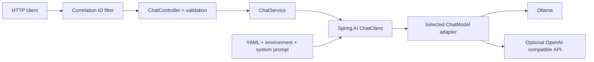

# AI Multi-Marketplace Laptop Finder

A Java learning project that will grow into an AI shopping assistant using **authorized marketplace data**. The backend is a Spring Boot modular monolith; AI features use **Spring AI**, rather than a hand-written HTTP chatbot.

## Current milestone: Phase 1 — Spring AI chat foundation

Implemented:

- `POST /api/chat`: a real, synchronous, stateless LLM call through Spring AI.
- Local **Ollama** configuration and an optional **OpenAI-compatible hosted** profile.
- A versioned system prompt, input validation, safe errors, and request correlation IDs.
- Configurable provider timeouts and retries; graceful shutdown and health endpoints.
- Deterministic JUnit 5 / Mockito / Spring Boot tests, plus an opt-in real-model smoke test.
- A checked-in [OpenAPI contract](docs/openapi.yaml) and basic backend CI.

**Not implemented yet:** marketplace search, product recommendations, structured search criteria, comparison, conversation memory, authentication, PostgreSQL, RAG, React, or deployment infrastructure. This is a development milestone, **not a production-ready public shopping service**. Chat answers are general guidance, not verified product data.

See the [Phase 1 guide](docs/phase-1.md) for the concepts, complete code map, execution flow, tests, and troubleshooting.

**Verified:** 28 deterministic tests passed, and a real Ollama model answered through both the service and the packaged HTTP endpoint on GitHub Actions. Exact run links and limitations are in the [verification log](docs/verification.md).

## Compatible version baseline

| Component | Version / choice |
|---|---|
| Java | 21 (LTS) |
| Spring Boot | 4.1.2 |
| Spring AI | 2.0.2 |
| Maven | 3.9.16 through the checked-in Maven Wrapper |
| Local model | `qwen2.5:7b-instruct` by default; configurable |
| Hosted model | `gpt-4.1-mini` by default; configurable |
| Tests | JUnit Jupiter, Mockito, AssertJ, Spring Boot Test |

Spring AI 2.0.x supports Boot 4.0.x / 4.1.x. The Spring AI BOM aligns its modules; the Boot parent manages Boot and testing dependencies. Do not mix this code with Spring AI 1.x property names or Boot 3 test imports. Stable releases use Maven Central; no snapshot repository is needed.

Upstream references: [Spring AI releases](https://github.com/spring-projects/spring-ai/releases), [Spring AI getting started](https://github.com/spring-projects/spring-ai/blob/v2.0.2/spring-ai-docs/src/main/antora/modules/ROOT/pages/getting-started.adoc), [Spring Boot releases](https://github.com/spring-projects/spring-boot/releases).

## Architecture



The controller knows HTTP, the service knows the application operation, and Spring AI knows the provider protocol. No provider SDK appears in the controller or service. See [architecture and sequence diagrams](docs/architecture.md).

## Quick start: local Ollama

### 1. Prerequisites

- JDK **21**, with `JAVA_HOME` set and `java` on your PATH.
- Git and curl.
- [Ollama](https://github.com/ollama/ollama), installed separately.
- Approximately 16 GB system RAM is a practical starting point for the default 7B model; actual requirements depend on quantization, context, and other running applications. Use a smaller model if necessary.

The Maven Wrapper supplies Maven. On Windows use `mvnw.cmd` in place of `./mvnw`.

### 2. Configure and start the model

```bash
cp .env.example .env
# Review .env; no key is needed for local Ollama.

ollama serve
```

If Ollama is already running as a desktop app or system service, do not start a second server. In another terminal:

```bash
ollama pull qwen2.5:7b-instruct
ollama list
curl --fail http://localhost:11434/api/tags
```

For a smaller connectivity-testing model:

```bash
ollama pull qwen2.5:0.5b-instruct
# Set OLLAMA_MODEL=qwen2.5:0.5b-instruct in your environment or local .env.
```

The small model is useful for checking wiring, **not** evidence of recommendation quality. A 3B model is a possible lower-memory compromise. Model weights are downloaded explicitly; the application never pulls weights at startup.

### 3. Run the backend

From the repository root, in a POSIX shell:

```bash
set -a
. ./.env
set +a
./mvnw spring-boot:run
```

Only source a `.env` file you trust: sourcing executes shell syntax. Spring Boot does **not** automatically read `.env`. Alternatively, configure environment variables in your IDE.

The default server binds to `127.0.0.1:8080`. In a trusted container or preview network, set `SERVER_ADDRESS=0.0.0.0`; never expose this unauthenticated development endpoint directly to the internet.

### 4. Call the endpoint

```bash
curl --fail http://localhost:8080/actuator/health

curl --fail -i http://localhost:8080/api/chat \
  -H 'Content-Type: application/json' \
  -d '{"message":"What should I consider when choosing a laptop for Java development and Docker?"}'
```

Response shape (the answer is generated, not a fixed product result):

```json
{
  "answer": "Consider CPU performance, sufficient RAM, SSD capacity, and operating-system compatibility..."
}
```

Every response includes `X-Request-ID`. Quote your request carefully: JSON containing Indian currency amounts or shell-sensitive characters is often easier to put in a file and send with `--data-binary @request.json`.

Health means the application is running; it deliberately does **not** call the LLM. Use the opt-in smoke test below to verify the actual provider connection.

## Optional hosted configuration

Set secrets in your shell, IDE, or deployment secret manager. **Never send a key in chat or commit it.** For example, enter it locally without shell history using a silent prompt:

```bash
read -rsp 'OpenAI API key: ' OPENAI_API_KEY
printf '\n'
export OPENAI_API_KEY
export SPRING_PROFILES_ACTIVE=hosted
export OPENAI_MODEL=gpt-4.1-mini
./mvnw spring-boot:run
```

PowerShell:

```powershell
$secret = Read-Host 'OpenAI API key' -AsSecureString
$env:OPENAI_API_KEY = [System.Net.NetworkCredential]::new('', $secret).Password
$env:SPRING_PROFILES_ACTIVE = 'hosted'
$env:OPENAI_MODEL = 'gpt-4.1-mini'
.\mvnw.cmd spring-boot:run
Remove-Item Env:OPENAI_API_KEY
```

Hosted calls may incur charges and send the prompt to the configured provider. `OPENAI_BASE_URL` can point to a compatible service, but use only a trusted endpoint: it receives your credential and prompt. Verify that service's model names, supported options, URL convention, data policy, and limits. The hosted adapter is configuration-tested; a real hosted call requires your own authorized credentials.

## Run and test

```bash
# Fast deterministic suite: no Ollama, hosted API, real key, or model download required.
./mvnw clean verify

# Build an executable JAR; tests still run.
./mvnw clean package
java -jar target/laptop-finder-0.1.0-SNAPSHOT.jar
```

With Ollama running and the configured model already pulled:

```bash
RUN_LIVE_AI_TESTS=true ./mvnw -Dtest=LiveModelSmokeTest test
```

Windows PowerShell: set `$env:RUN_LIVE_AI_TESTS='true'`, run `.\mvnw.cmd -Dtest=LiveModelSmokeTest test`, then remove the variable. The live test checks nonempty output through the real adapter; it does not judge exact wording or shopping quality. CI has a separate, manually dispatched live Ollama workflow.

## Configuration

| Variable | Default | Purpose |
|---|---|---|
| `OLLAMA_BASE_URL` | `http://localhost:11434` | Local/server model endpoint |
| `OLLAMA_MODEL` | `qwen2.5:7b-instruct` | Installed Ollama model tag |
| `SPRING_PROFILES_ACTIVE` | unset | Set `hosted` for the hosted adapter |
| `OPENAI_API_KEY` | none | Required in hosted profile; never committed |
| `OPENAI_BASE_URL` | `https://api.openai.com` | Trusted compatible API base URL |
| `OPENAI_MODEL` | `gpt-4.1-mini` | Hosted model available to your account |
| `AI_CONNECT_TIMEOUT` | `5s` | Ollama HTTP connection timeout |
| `AI_READ_TIMEOUT` | `60s` | HTTP read / hosted request timeout |
| `AI_MAX_ATTEMPTS` | `1` | Total Ollama attempts; 1 disables retries |
| `OPENAI_MAX_RETRIES` | `0` | Additional hosted SDK retries |
| `SERVER_ADDRESS` | `127.0.0.1` | Local-first network binding |
| `SERVER_PORT` | `8080` | HTTP port |

Ollama uses Spring's shared HTTP client timeout settings and Spring AI retry settings. The hosted SDK uses its own timeout/retry properties. Retries can increase latency and cost; there is no application-level retry loop on top.

## API and safety boundaries

- [OpenAPI 3.0 contract](docs/openapi.yaml)
- Request: `message`, nonblank, maximum 4000 Java characters (UTF-16 code units).
- Success: `answer`, nonblank. Empty model output becomes HTTP 502.
- Invalid input: 400; provider failure: 503; errors use a stable, sanitized envelope.
- User text stays in the user-message role. This reduces prompt-role confusion but is **not** a guarantee against prompt injection.
- No chat history or prompt bodies are persisted or logged by application code.
- No marketplace links, prices, stock, or specifications are retrieved in Phase 1.

Authentication, authorization, rate limiting, persistent conversation isolation, broader metrics export, and deployment hardening are later milestones. The default local binding is a safety measure, not a substitute for those controls.

## Repository and milestone workflow

The requested repository name is `ai-multimarketplace-laptop-finder`. This Arena checkout started in the existing public repository `anushkasomi01/AI-Product-Comparator`, on the fixed session branch `arena/3c24c2ea-ai-product-comparator`. The available GitHub integration can push that branch but cannot create another repository. Follow [GitHub setup and milestone workflow](docs/github-workflow.md) to create the requested repository and add it as a second remote without changing the session branch.

Before each milestone commit:

```bash
./mvnw clean verify
git status --short
git diff
git diff --cached
bash scripts/check-no-secrets.sh
```

Stage explicit paths, review the staged diff, then commit using Conventional Commits. The exact Phase 1 paths and commands are in the GitHub guide. The guard is a lightweight helper, not a complete secret scanner. Enable GitHub secret scanning and push protection on the public repository when available.

## Roadmap

1. **Phase 1 (this milestone): Spring AI chat foundation.**
2. Phase 2: validated structured search criteria; no LLM budget arithmetic.
3. Phases 3–4: normalized synthetic products, exact filtering, comparison, deduplication, ranking.
4. Phases 5–6: investigate and integrate only authorized marketplace APIs; isolate partial failures.
5. Phase 7: React/TypeScript interface and controlled conversational context.
6. Phase 8: legally usable RAG sources, PostgreSQL/pgvector, evaluation, security, observability.
7. Phase 9: Docker Compose, expanded CI/CD, deployment documentation, optional AWS.

Marketplace credentials and permissions are not assumed. Mock data will always be labelled synthetic. See [assumptions and limitations](docs/limitations.md).
