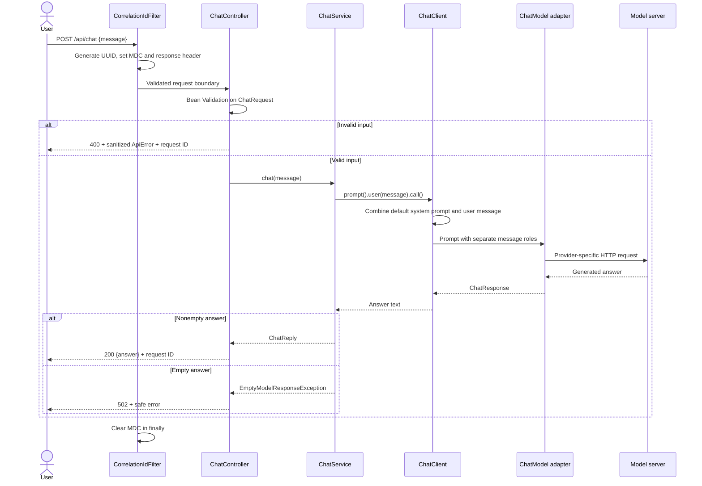

# Phase 1 architecture

## Start with a modular monolith

One deployable Spring Boot application contains small packages with explicit responsibilities. This gives module boundaries without the operational overhead of microservices.

```mermaid
flowchart TB
    subgraph Boot[Spring Boot application]
        subgraph API[api]
            Filter[CorrelationIdFilter]
            Controller[ChatController]
            Errors[ApiExceptionHandler]
            DTO[ChatRequest / ChatReply / ApiError]
        end
        subgraph AI[ai]
            Configuration[ChatConfiguration]
            Service[ChatService]
            Prompt[assistant-system.txt]
        end
        SpringAI[Spring AI ChatClient and ChatModel]
    end
    Provider[Ollama or hosted model API]
    Settings[application.yml / environment]
    Client[HTTP client] --> Filter --> Controller --> Service
    Controller --> DTO
    Controller -. exceptions .-> Errors
    Configuration --> SpringAI
    Prompt --> Configuration
    Service --> SpringAI --> Provider
    Settings --> SpringAI
```

The correlation filter lives in the `observability` package; the diagram groups it with the HTTP path for readability.

| Boundary | Responsibility | Must not know |
|---|---|---|
| API | HTTP, validation, stable response/error contracts | Provider SDKs or credentials |
| AI service | One application-level chat operation | Whether the model is local or hosted |
| AI configuration | System prompt and ChatClient construction | Marketplace rules |
| Spring AI adapter | Provider protocol, messages, model options | Our HTTP DTOs |
| Configuration | Endpoint, model, timeout, retry, secret references | Business decisions |

## Sequence: one chat request

Provider errors are wrapped at the service boundary and translated to 503 without returning upstream messages. Timeouts are provider-specific configuration, not an instruction to the LLM.

## Why this is a real AI application

The answer is generated by the configured model through Spring AI. There is no canned response fallback masquerading as AI. Tests substitute the model only at the test boundary. The system prompt establishes behavior; it does not supply verified marketplace facts.

Phase 1 intentionally does not add agents or tools. An agent decides on actions; this endpoint performs one model call. Later, tool calling will let the model propose a search while Java validates criteria and executes authorized provider calls. RAG will retrieve supporting passages; it is not the same thing as conversation memory.

## State and trust

- Stateless: no `ChatMemory`, session store, or shared mutable message list.
- User input cannot set the system role, provider URL, model, or API key through the request body.
- Client-provided correlation IDs are ignored; a fresh UUID avoids log injection.
- The default network bind is loopback. There is no authentication yet.
- Prompt role separation and the system prompt are defense measures, not a security guarantee.
- No marketplace source exists yet; model output must not be represented as verified product data.

## Deliberate deferrals

PostgreSQL/pgvector, marketplace adapters, security filters, rate limits, memory, tool execution, RAG, and a frontend would obscure the first model-integration milestone. Their packages and infrastructure will be introduced when the corresponding behavior needs them.
